# Sistema de inventario y ventas — Tienda de componentes electrónicos

Aplicación de consola en **Python + SQLite** (`sqlite3`) para administrar productos y registrar ventas,
garantizando que **venta e inventario nunca queden inconsistentes** gracias a transacciones.

## Ejecución
Requisitos: Python 3.8+ (sqlite3 viene incluido; no hay dependencias externas).
```bash
git clone <URL_DEL_REPOSITORIO>
cd tienda
python main.py            # aplicación con menú interactivo (crea tienda.db y las tablas solo)
python demo_rollback.py   # demostración del rollback con error controlado
```

## Estructura
| Archivo | Función |
|---|---|
| `db.py` | Conexión, creación de tablas, CRUD, venta transaccional, historial (JOIN) |
| `main.py` | Menú interactivo y validación de entradas |
| `demo_rollback.py` | Prueba automática del rollback |
| `evidencias/` | Salidas reales de ejecución (`01_sesion_menu.txt`, `02_demo_rollback.txt`) |

---
## Parte 1 — Análisis y diseño

### 1. Entidades y atributos
- **Producto**: id, nombre, precio, cantidad (stock).
- **Venta**: id, producto (referencia), cantidad vendida, precio unitario al momento de la venta, total, fecha.

*Se guarda `precio_unitario` en la venta para que el historial no cambie si luego se modifica el precio del producto.*

### 2. Modelo de datos
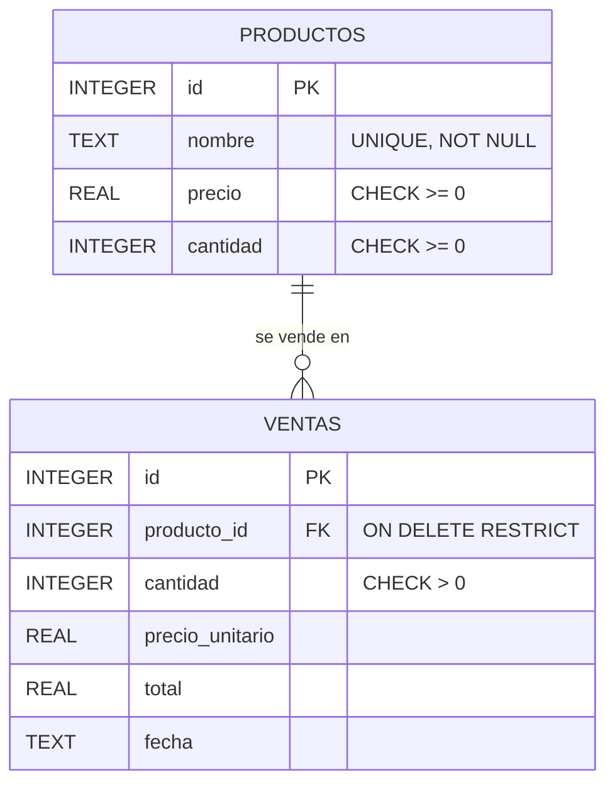
Relación 1:N: un producto puede tener muchas ventas. `ON DELETE RESTRICT` + `PRAGMA foreign_keys=ON`
impiden borrar un producto con ventas (se conserva el historial). Los `CHECK` evitan stock negativo a nivel de BD.

### 3. Diagrama de arquitectura
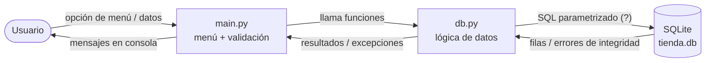
Arquitectura en capas: **presentación** (`main.py`) separada de **acceso a datos** (`db.py`).
Todas las consultas usan parámetros `?` (previene inyección SQL).

### 4. Operaciones al registrar una venta
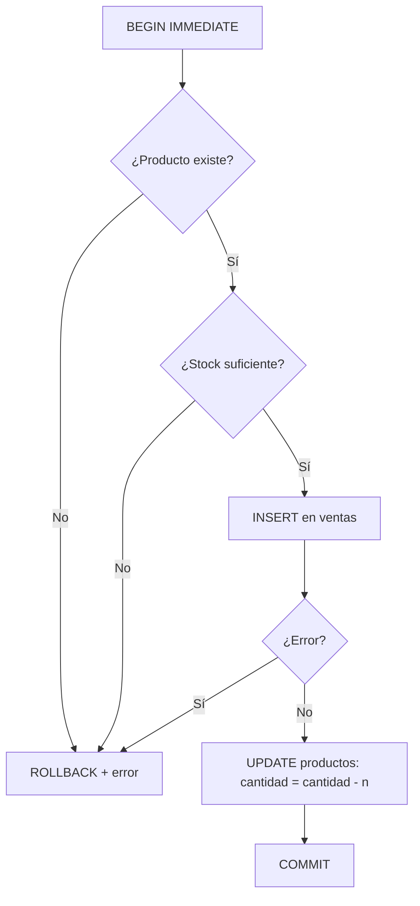

---
## Parte 3 — Explicación de la transacción
Una venta implica **dos escrituras** (insertar en `ventas` y descontar en `productos`) que deben ocurrir
**juntas o ninguna** (atomicidad). `registrar_venta()` abre la transacción con `BEGIN IMMEDIATE`, valida existencia
y stock, inserta la venta, descuenta el inventario y hace `COMMIT`. Si **cualquier** excepción ocurre en el medio,
el bloque `except` ejecuta `ROLLBACK`, deshaciendo también la venta ya insertada.

**Reto del rollback:** el parámetro `simular_error=True` lanza una excepción justo *después* del `INSERT` y *antes*
del `UPDATE`. Resultado real (`evidencias/02_demo_rollback.txt`):
```
[ANTES   ] stock = 10 | ventas registradas = 0
   Excepción capturada: Fallo simulado entre el INSERT de la venta y el UPDATE del inventario.
[DESPUÉS ] stock = 10 | ventas registradas = 0
RESULTADO: ✓ Datos intactos (rollback correcto)
```
También se puede probar desde el menú con la opción **7**.

## Evidencias de ejecución
Ver `evidencias/`. Para los pantallazos solicitados, ejecuta `python main.py` y `python demo_rollback.py`
y captura la terminal (el contenido debe coincidir con los `.txt`).

### 1. Registrar y consultar productos
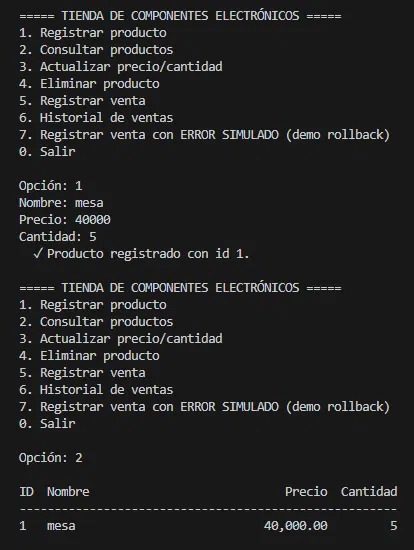

### 2. Actualizar producto
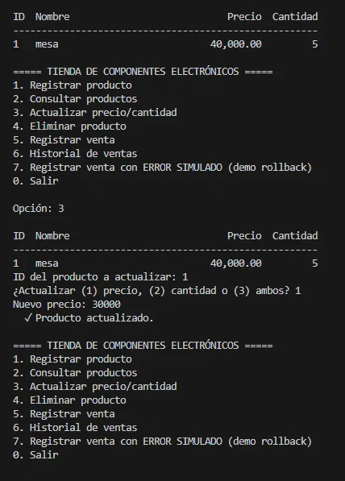

### 3. Eliminar producto
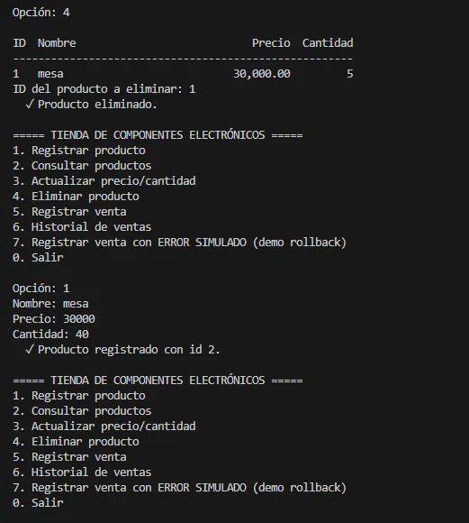

### 4. Venta exitosa (COMMIT) y validación de producto inexistente
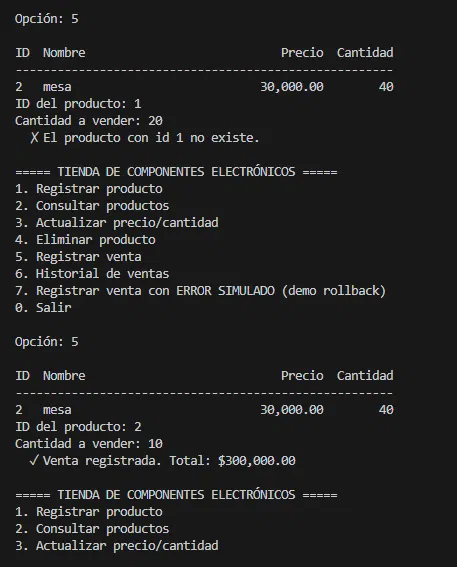

### 5. Historial de ventas con JOIN
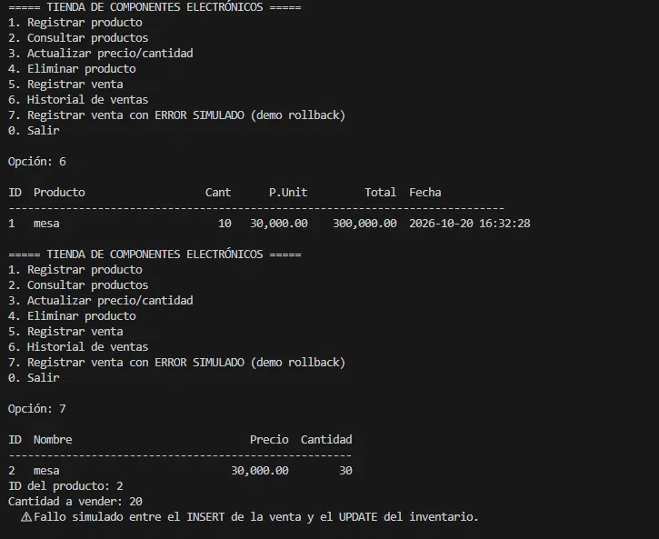

### 6. Rollback: error simulado
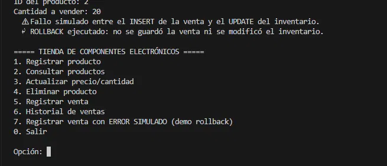

### 7. Stock insuficiente
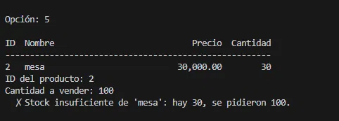

### 8. Integridad referencial y verificación tras el rollback
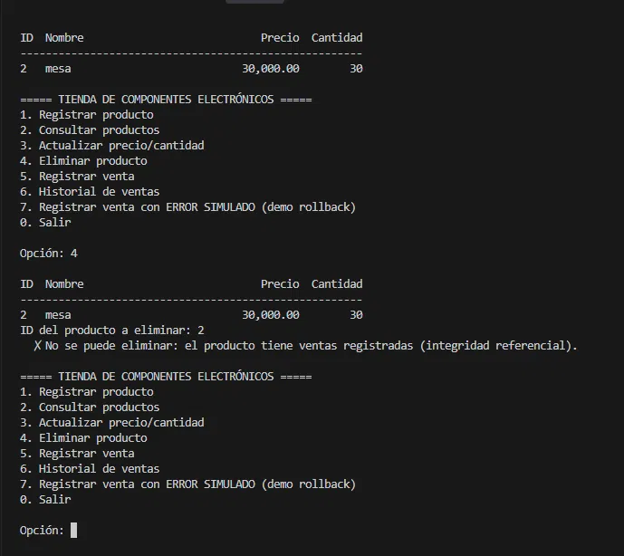
